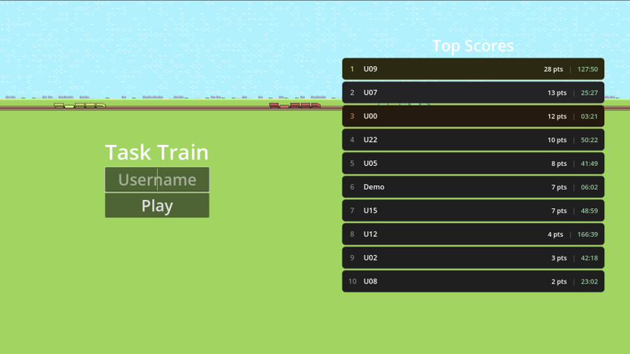

---

## Overview

What it is and what you learned.

### More

- hello

`code`

```py
for i in range(10):
  print(i)
```

Hello | Hello | Silly

> quote

[external link](https://youtube.com)

[internal link](/projects/b1ts-f1b)



<!-- This is a comment -->